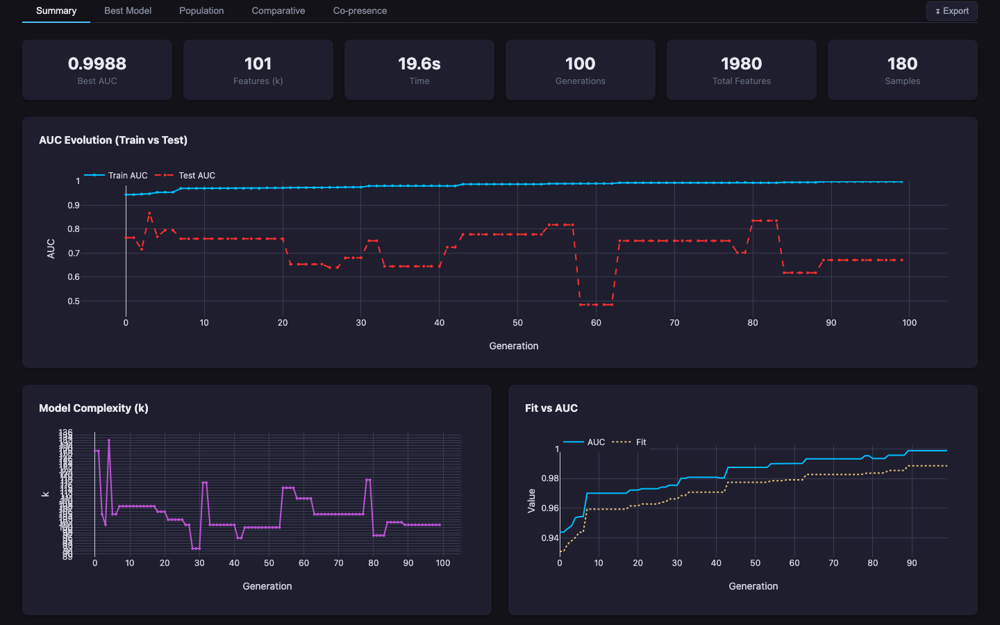

# PredomicsApp

PredomicsApp is a web application for building **interpretable predictive models
from microbiome (and other omics) data**. It is the graphical front end of the
[gpredomics](https://github.com/predomics/gpredomics) engine, which searches for
sparse models — a handful of features combined with simple rules — that a
biologist can read, discuss and validate.

It is meant for biologists and bioinformaticians who want to go from an
abundance table and a class label to a validated signature without writing
code, and for labs that want to run this on their own server.



With it you can:

- load a demo dataset or upload your own (feature table + labels, optional test set and metadata);
- explore the data (feature statistics, prevalence, ordination, co-abundance networks, taxonomic annotations);
- configure and launch analyses (genetic algorithm, beam search, MCMC, simulated annealing, LASSO, ILS, ACO, and scikit-learn baselines for comparison);
- follow jobs live, then read the results (best model, model population, feature importance, stability, enrichment);
- compare runs, share projects with colleagues or through a public link, and export reports (HTML, PDF, CSV, JSON, notebooks).

More screenshots are in [`docs/screenshots/`](docs/screenshots/). The scientific
method is described on the project website, <https://predomics.github.io>, and in
[Prifti et al., GigaScience 2020](https://doi.org/10.1093/gigascience/giaa010).

---

## Quick start (local, Docker)

**Prerequisites**

| | |
|---|---|
| Docker | Docker Desktop or Docker Engine 23+, with **Docker Compose 2.24+** (`docker compose version`) |
| Memory | 4 GB free for Docker during the build; 4 GB or more to run analyses |
| Disk | about 6 GB for the build, 1.5 GB for the final image |
| Network | a stable connection for the first build (see below) |
| Time | **10–25 minutes for the first build**: it compiles the gpredomics engine from Rust. Later builds take a minute or two. |

```bash
git clone https://github.com/predomics/predomicsapp.git
cd predomicsapp
docker compose up -d --build
```

Then open **<http://localhost:8001>**.

The first build downloads from Docker Hub, `sh.rustup.rs` / `static.rust-lang.org`,
`github.com` (engine sources), `crates.io`, `pypi.org` and `registry.npmjs.org`.
If a download fails on a poor connection, run the same command again: finished
steps are cached and the downloads retry.

To check that everything is up:

```bash
docker compose ps                        # both containers "healthy"
curl -s http://localhost:8001/health     # "gpredomicspy_available": true
```

### Ports

| Service | Address | Change it with |
|---|---|---|
| Application (UI + API) | `http://localhost:8001` | `PREDOMICS_PORT` |
| PostgreSQL | `localhost:5433` (user `predomics`) | `PREDOMICS_DB_PORT` |

Both are published on `127.0.0.1` only (not reachable from other machines).
If a port is already taken, choose another one — on the command line or in a
`.env` file next to `docker-compose.yml`:

```bash
PREDOMICS_PORT=8002 PREDOMICS_DB_PORT=5434 docker compose up -d --build
```

To reach the app from other machines, use the production stack
([DEPLOYMENT.md](DEPLOYMENT.md)) rather than exposing this one.

### First login

1. Open the app and choose **Register** to create your account (passwords need
   at least 8 characters). A session lasts 8 hours and is renewed while you
   use the application.
2. **Becoming administrator.** The account whose email equals
   `PREDOMICS_ADMIN_EMAIL` gets administrator rights (user management, backups,
   default parameters). Set it before or after registering:

   ```bash
   echo 'PREDOMICS_ADMIN_EMAIL=you@example.org' >> .env
   docker compose up -d
   ```

   Without it, an instance has no administrator.
3. **Demo account.** There is none by default. Setting `PREDOMICS_SEED_DEMO=true`
   creates `demo@predomics.com` with password `demo` — handy for a workshop on a
   private network, never to be enabled on a public server.
4. **Forgotten password.** With an SMTP server configured (see
   [DEPLOYMENT.md](DEPLOYMENT.md#email-and-password-reset)) users receive a
   reset link by email. Without one, an administrator sets a new password for
   the user through the API (`POST /api/admin/users/{user_id}/reset-password`,
   try it from `/api/docs`). After several wrong passwords the server makes
   you wait before the next attempt.

The fastest way to see the whole workflow is the **Load** button next to a demo
dataset on the Projects page (for example *Qin2014 Liver Cirrhosis*), then
**Parameters & Run → Launch**.

### Your data, and how to reset it

Everything you create lives in two Docker volumes, which survive
`docker compose down`, rebuilds and upgrades:

| Volume | Content |
|---|---|
| `predomics_pg-data` | the database: accounts, projects, job records |
| `predomics_app-data` | uploaded files, job results, caches, and the generated key in `.secret_key` |

```bash
docker compose down          # stop; keep all data
docker compose down -v       # stop and ERASE all accounts, projects and results
```

So if you start the stack again months later, the accounts you created before
are still there.

---

## Using the application

- **[Tutorial](docs/tutorial.md)**: the demo dataset from login to reading
  each results tab, with what the main parameters and metrics mean.
- Input format: tab-separated tables. The feature table has features in rows
  and samples in columns (or the reverse, tick *Features in rows* accordingly);
  the label file has one line per sample (`sample<TAB>class`). The demo datasets
  in [`samples/`](samples/) are worked examples, each with a README.
- Every parameter in the *Parameters & Run* tab has an explanation (the “i” next
  to its name).
- Methods, model languages and how to read the results: <https://predomics.github.io>.
- Scripting: the **[API guide](docs/api-guide.md)** runs an analysis end to
  end with `curl`. The interactive reference is at `/api/docs` (Swagger) and
  `/api/redoc` on your instance — for example <http://localhost:8001/api/docs>.
  Authenticate with the token returned by `POST /api/auth/login`
  (`Authorization: Bearer …`) or with an API key created in your profile
  (`X-API-Key: …`).

## Network access at run time

The application works offline except for two optional features:

| Feature | Contacts | If unreachable |
|---|---|---|
| Taxonomic and functional annotation of `msp_…` features | `biobanks.gmt.bio` (only the MSP identifiers are sent) | annotations are missing; everything else works. Results are cached in the data volume. |
| Charts inside exported HTML reports | `cdn.plot.ly` (from the reader's browser) | the exported report shows no charts when opened offline |

## Deploying on a server

[DEPLOYMENT.md](DEPLOYMENT.md) covers the production stack (HTTPS, backups,
resource limits), every setting, upgrades, backup and restore, and Kubernetes.
Short version:

```bash
./scripts/setup.sh           # asks a few questions, writes .env
./scripts/ssl-init.sh        # first HTTPS certificate
docker compose -f docker-compose.yml -f docker-compose.prod.yml up -d --build
```

## Development and tests

[CONTRIBUTING.md](CONTRIBUTING.md) describes the development stack with hot
reload and how to run the test suites; [docs/architecture.md](docs/architecture.md)
is a map of the code. Everything runs in Docker:

```bash
make dev             # frontend http://localhost:5173, API http://localhost:8000
make test-backend    # pytest (real engine)
make test-frontend   # vitest
make test-e2e        # Playwright in a browser, on its own throwaway stack
make check-upgrade   # the image upgrades a database of the previous release
```

## Repository layout

```
backend/     FastAPI application (API, job runner, data analysis)
frontend/    Vue 3 single-page application
samples/     bundled demo datasets (each with a README)
scripts/     setup, SSL, backup and restore scripts
nginx/       reverse-proxy templates for the production stack
helm/        Kubernetes chart
tests/e2e/   end-to-end tests (Playwright)
docs/        screenshots and technical notes
```

Related repositories: [gpredomics](https://github.com/predomics/gpredomics)
(Rust engine) and [gpredomicspy](https://github.com/predomics/gpredomicspy)
(Python bindings). The image is built against pinned commits of both; the
running instance reports them at `/health`.

## Versions

The application version is the git tag (`vX.Y.Z`), mirrored in
`backend/pyproject.toml`; `/health` reports it together with the engine
commits. Changes are listed in [CHANGELOG.md](CHANGELOG.md); planned work in
[ROADMAP.md](ROADMAP.md).

## Citing

If you use PredomicsApp or gpredomics in your work, please cite:

> Prifti E, Chevaleyre Y, Hanczar B, Belda E, Danchin A, Clément K, Zucker J-D.
> Interpretable and accurate prediction models for metagenomics data.
> *GigaScience* 2020;9(3):giaa010. <https://doi.org/10.1093/gigascience/giaa010>

Machine-readable citation: [CITATION.cff](CITATION.cff).

## Licence

**To be confirmed by the project owners.** The repository does not contain a
`LICENSE` file yet, and the sources disagree (the application's Credits page
says GPL-3.0; an older technical document says proprietary). The engine
bindings it embeds, gpredomicspy, are GPL-3.0. Until a licence file is added,
ask the maintainers before redistributing or modifying the software. The demo
datasets come from published studies; see the README in each `samples/`
sub-directory for their sources.

## Security

Please report vulnerabilities privately — see [SECURITY.md](SECURITY.md).
